# DoN Range labs for Labtainers

This repository distributes the instructor-provided Labtainers module (the "imodule") and the
`donlab` launcher for the DoN Range labs (CS3600 / CS3670 / CS3690); `donlab` fetches what it
needs from here at every lab start, so you do not need to clone it.

This single page takes you from nothing installed to a finished, submitted lab, with screenshots
and short clips at each step.

## Contents
1. [What you need before you start](#1-what-you-need-before-you-start)
2. [Specs: minimum vs recommended](#2-specs-minimum-vs-recommended)
3. [Which image and hypervisor?](#3-which-image-and-hypervisor)
4. [Setup A — x86 (Windows / Linux / Intel Mac)](#4-setup-a--x86-windows--linux--intel-mac)
5. [Setup B — Apple-Silicon Mac (arm64)](#5-setup-b--apple-silicon-mac-arm64)
6. [Run your first lab (the same on every platform)](#6-run-your-first-lab-the-same-on-every-platform)
7. [Troubleshooting / FAQ](#7-troubleshooting--faq)
8. [Lab ids and next steps](#8-lab-ids-and-next-steps)

---

## 1. What you need before you start

Four things, in order:

1. **A hypervisor** — the software that runs the VM: **VirtualBox**, **VMware**, or (Apple
   Silicon) **UTM**. Which one depends on your machine; you install it in your setup section
   (see [section 3](#3-which-image-and-hypervisor)).
2. **The appliance** — the pre-built Labtainers VM. For **x86-64** machines it is the official
   **NPS virtual-machine-images page**; for an **Apple-Silicon Mac** it is the **OneDrive folder**
   (links in [section 3](#3-which-image-and-hypervisor)).
3. **Your VM login** — the student account inside the appliance; both the NPS and the OneDrive
   appliances use **`student` / `password123`**.
4. **Your course key** — `cs3670` (and `cs3600` / `cs3690` if you take those); it unlocks the
   course's labs. Install it once with `donlab --key` (see [section 6.2](#62-install-your-course-key)).

On the host side: a **64-bit** operating system, and — on an **Intel/AMD PC or Intel Mac** —
**CPU virtualization** (Intel VT-x / AMD-V) enabled in BIOS/UEFI. It is on by default on most
machines; without it the VM will not start. **Apple-Silicon Macs need no such setting.**

**What's next:** check your machine against the specs below, then jump to your setup —
[Setup A](#4-setup-a--x86-windows--linux--intel-mac) for x86, or
[Setup B](#5-setup-b--apple-silicon-mac-arm64) for Apple Silicon.

---

## 2. Specs: minimum vs recommended

| Resource | Minimum | Recommended |
|---|---|---|
| Host OS | 64-bit Windows 10/11, macOS, or Linux (current release) | — |
| Host RAM | 16 GB (the VM uses 8 GB) | 16 GB+ (scales with what you allot the guest) |
| Guest RAM | 8 GB | 8 GB+ (raise it only if your host can spare it) |
| Guest vCPU | 2 | 4+ (more if you have the cores) |
| Free host disk | ~80 GB | ~120 GB+ |

The "+" means *this or more, as long as you don't starve the host OS*. The guest VM ships at
**8 GB RAM / 60 GB virtual disk**; the virtual disk grows as labs run and pull images, and the
~5 GB download plus the import need headroom, which is why ~80 GB free is the floor.

These are a baseline, not a guarantee for every machine. Adjust the VM's vCPU, RAM, disk and other
hypervisor settings — **display/graphics especially**, plus clipboard and networking — to suit your
hardware; some experimentation may be needed.

---

## 3. Which image and hypervisor?

Labtainers runs inside a Linux virtual machine. **Native-first:** run the appliance that matches
your machine's CPU architecture, virtualized natively.

| Your machine | Hypervisors | Appliance (source) |
|---|---|---|
| Windows / Linux PC (x86-64) | **VirtualBox** or **VMware Workstation** | x86_64 `.ova` — [NPS page](https://nps.edu/web/c3o/virtual-machine-images) |
| **Intel Mac** (x86-64, native) | **VirtualBox** or **VMware Fusion** | x86_64 `.ova` — [NPS page](https://nps.edu/web/c3o/virtual-machine-images) |
| Apple-Silicon Mac (arm64) | **VirtualBox (preferred)**, **VMware Fusion**, or **UTM** | arm64 `.ova` (VirtualBox / Fusion) or `.utm.zip` (UTM) — [OneDrive](https://nps01-my.sharepoint.com/:f:/g/personal/spencer_dollahite_nps_edu/IgAZgs-majINRZLvHu-oPPj0AQei1zJ9S0xHeJThBPQamjE) |
| Windows with Hyper-V | the VHDX image on the NPS page (work in progress there) | [NPS page](https://nps.edu/web/c3o/virtual-machine-images) |
| A machine that cannot meet the specs | a Labtainers cloud VM in a browser | the "Cloud Labtainers" section of the [Student Guide](https://github.com/mfthomps/Labtainers/raw/master/docs/student/labtainer-student.pdf) |

VirtualBox and UTM need **no account**. **VMware** Workstation (Windows/Linux) and Fusion (Mac)
are free but require creating a **Broadcom account** to download; the appliance imports the same
way. **VirtualBox is the recommended choice.**

> **Emulation is a last resort — only if no native appliance works.** On an Apple-Silicon Mac it
> means running the **official NPS x86 appliance** under x86 emulation (the NPS page's **x86_64
> QCOW2** is for this; UTM runs it emulated). It is slow. This is a different image from the
> **arm64** OneDrive appliances (section 5), which are our own native builds and the fast, preferred
> path. The [Labtainer-ARM-mac](https://github.com/spencer-dollahite/Labtainer-ARM-mac) guide
> covers both routes.

**What's next:** [Setup A](#4-setup-a--x86-windows--linux--intel-mac) (x86) or
[Setup B](#5-setup-b--apple-silicon-mac-arm64) (Apple Silicon). Do **one**, then everyone does
[section 6](#6-run-your-first-lab-the-same-on-every-platform).

---

## 4. Setup A — x86 (Windows / Linux / Intel Mac)

Use this if your computer has an Intel or AMD processor — any Windows PC, Linux PC, or **Intel
Mac** (an Intel Mac runs the x86_64 appliance natively, not emulated).

### 4.1 Install your hypervisor

Pick one and install it:

- **VirtualBox** — [virtualbox.org/wiki/Downloads](https://www.virtualbox.org/wiki/Downloads);
  no account. Accept the installer defaults (approve the driver / brief network-reset prompt).
- **VMware Workstation** (Windows/Linux) or **Fusion** (Intel Mac) — free, needs a Broadcom account.

### 4.2 Download the x86_64 appliance (NPS page)

Open the official **NPS Labtainers virtual-machine-images page** and download the x86_64 **`.ova`**
for your hypervisor — one is labeled VirtualBox, one VMware (`LabtainerVM24a-VMWare.ova`). It is
several GB — allow time and do not cancel. Then check its SHA-256 against the value on the page: on
Windows run `certutil -hashfile <file> SHA256`, on Linux `sha256sum <file>`, on a Mac
`shasum -a 256 <file>`.

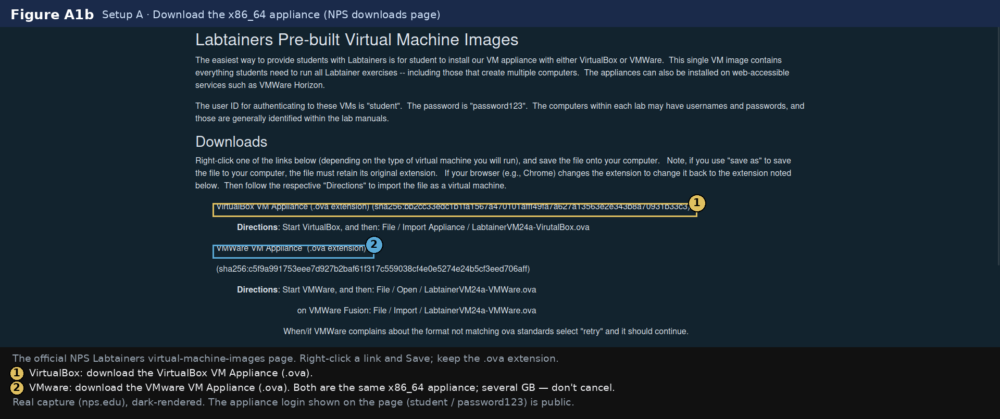

The appliance login shown on that page is **user `student` / password `password123`** (public).

### 4.3 Import the appliance

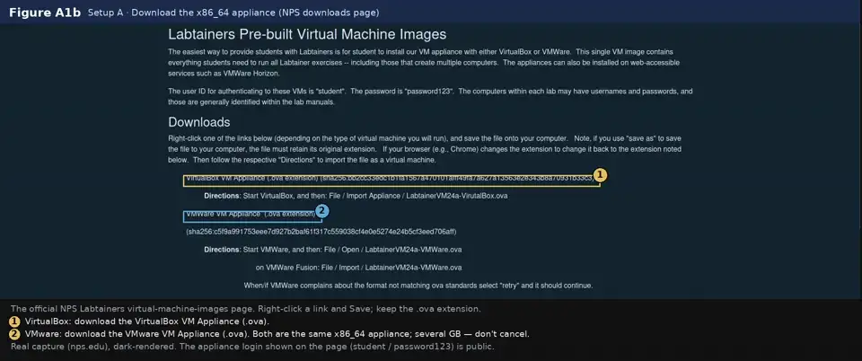

**VirtualBox:**

1. **File → Import Appliance** (the **Import** toolbar button does the same).

   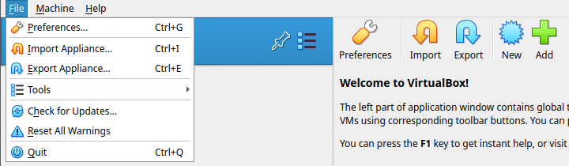

2. Leave **Source** at *Local File System*, pick the `.ova` in the **File** field, **Next**.

   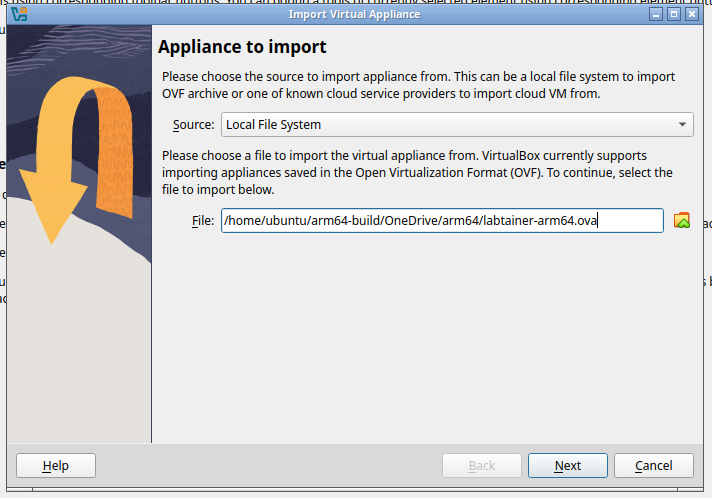

3. The **Appliance settings** page lists the VM. Give it the RAM/CPU from
   [section 2](#2-specs-minimum-vs-recommended), then **Finish**.

   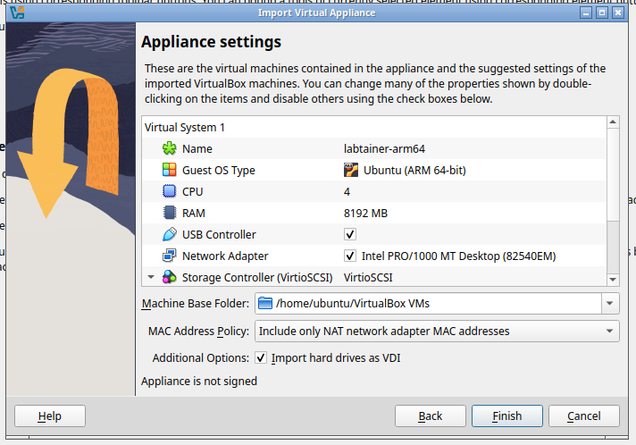

4. The import runs for a few minutes (progress in the right-hand panel); the VM then appears in
   the list.

   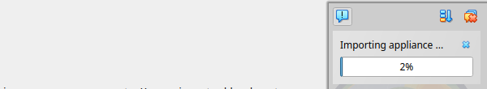

5. Select the VM and click **Start**.

*(The screenshots show VirtualBox 7.1 importing our `.ova`; the NPS x86_64 file uses the same
dialogs.)*

**Windows 11 hosts (VirtualBox).** With the VM powered off, under **Settings → Display** set
**Graphics Controller: VMSVGA**, **Video Memory: 128 MB**, **3D Acceleration: off** (3D on has
stopped Firefox opening inside the lab on some machines). A green turtle icon means Hyper-V is
forcing VirtualBox into slow compatibility mode — the VirtualBox manual explains how to disable it.
Run `donlab` on the VM's own desktop, not over SSH.

**VMware (Workstation / Player / Fusion):** install it, download `LabtainerVM24a-VMWare.ova`,
check its SHA-256, then **File → Open** (Workstation/Player) or **File → Import** (Fusion),
select the `.ova`, accept the defaults, and start the VM. (If VMware complains the format does not
match OVA standards, choose **Retry**.) The appliance does not auto-update Ubuntu; decline the
update prompt if it appears.

### 4.4 First boot and login

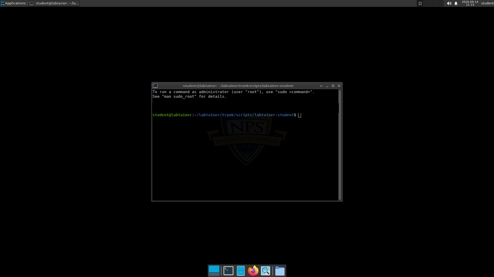

You may first see a login screen. Sign in (`student` / `password123` on the NPS appliance), then
reach the desktop. On first boot the appliance updates Labtainers itself; let it finish.

> **Fresh-appliance note:** the first `donlab` run may set up the **i3** desktop the labs use and
> **reboot the VM once** — log back in and continue. You can do that setup explicitly first with
> `donlab --init` ([section 6.3](#63-set-up-the-vm-once-donlab---init)).

**What's next:** [section 6 — run your first lab](#6-run-your-first-lab-the-same-on-every-platform).

---

## 5. Setup B — Apple-Silicon Mac (arm64)

Use this if your computer is a Mac with Apple Silicon (M1/M2/M3/M4). It runs the **arm64**
appliance natively.

### 5.1 Install your hypervisor

Apple Silicon runs the arm64 appliance natively on three hypervisors. Pick one:

- **VirtualBox** (recommended on Apple Silicon; no account) — import the arm64 `.ova`.
- **VMware Fusion** (free; Broadcom account) — import the arm64 `.ova`.
- **UTM** — [mac.getutm.app](https://mac.getutm.app/) (no account) — use the `.utm.zip`.

### 5.2 Download the appliance (OneDrive)

Open the **OneDrive folder** (linked in [section 3](#3-which-image-and-hypervisor)) — these are our
own custom-built **arm64 native** appliances (distinct from the official NPS x86 images). Download
the file for your hypervisor (each has a `.sha256` beside it):

- **VirtualBox or VMware Fusion:** download the arm64 **`.ova`** (several GB; don't cancel). It
  imports directly — no unzip.
- **UTM:** download the **`.utm.zip`**, then **double-click it** so macOS Archive Utility extracts
  the `.utm` bundle.

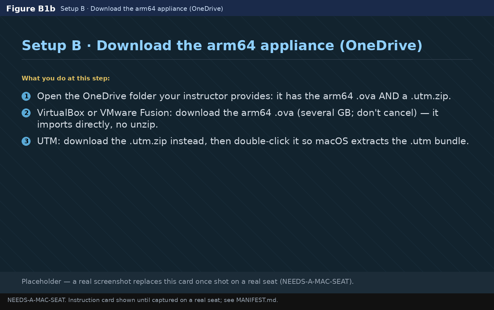

Verify your download, e.g. `shasum -a 256 ~/Downloads/<file>` and compare with the `.sha256`.

### 5.3 Import the appliance

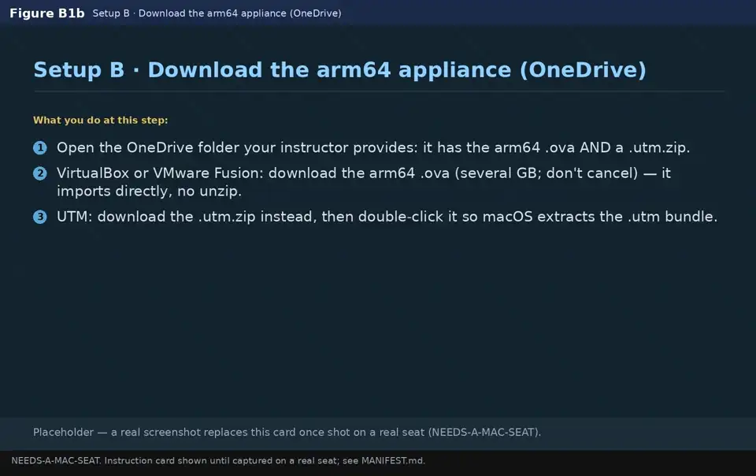

**VirtualBox / VMware Fusion:** import the `.ova` exactly as in
[Setup A 4.3](#43-import-the-appliance) (**File → Import Appliance** / **File → Import**).

**UTM:**

1. Open UTM; click **+** (or the *Create a New Virtual Machine* tile).

   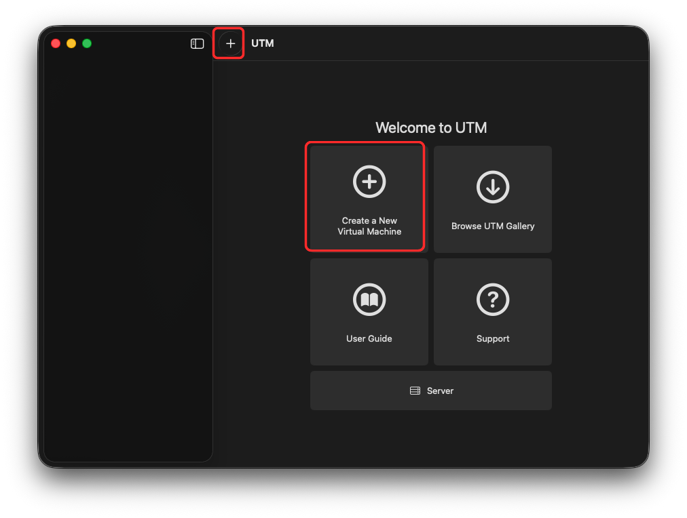

2. Under **Existing**, click **Open…** and choose the `.utm` bundle (double-clicking it in Finder
   does the same).

   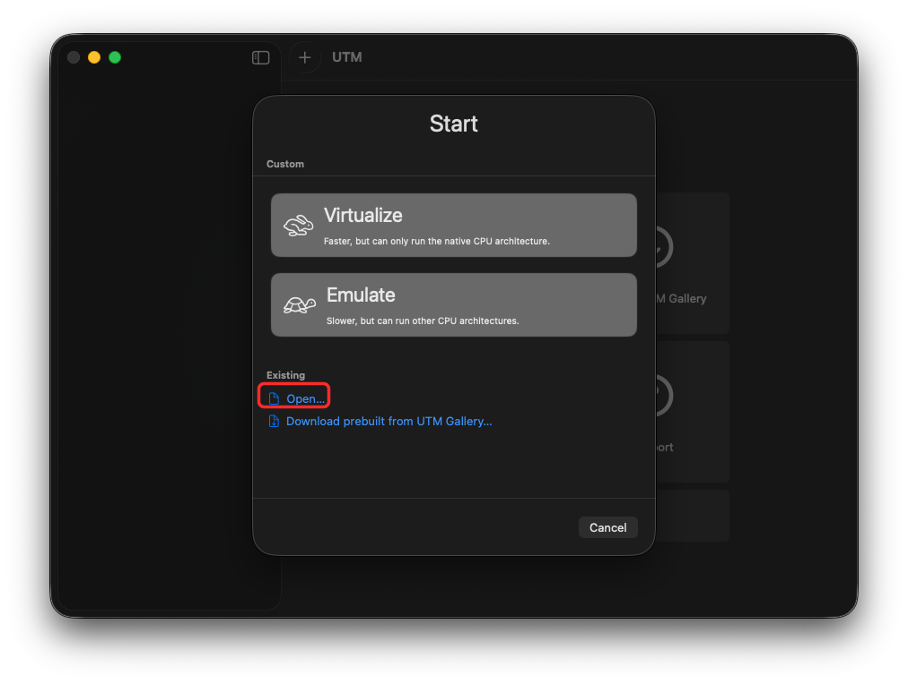

3. The VM appears as **Labtainers ARM** (pre-configured: Virtualize, aarch64, 4 cores, 8 GB,
   Emulated VLAN networking, clipboard sharing). Start it and log in (**`student` /
   `password123`**).

   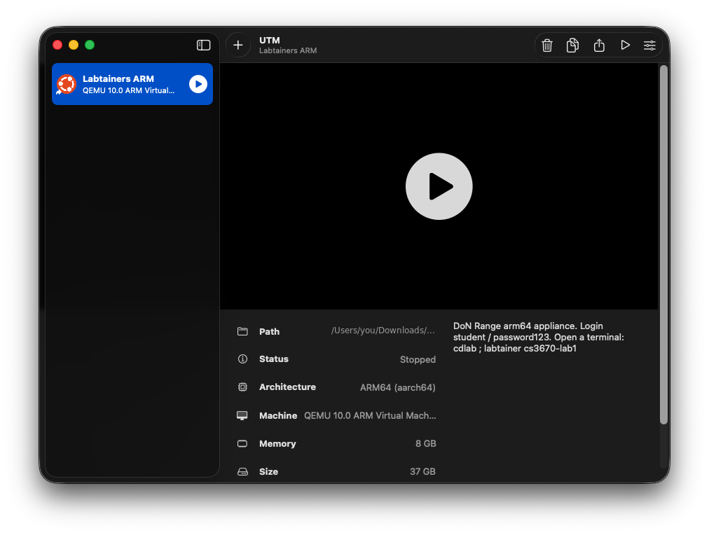

UTM has no snapshots; use VirtualBox or Fusion if you want them, or clone the `.utm` bundle. If
the VM loses its network after the Mac sleeps or changes Wi-Fi, shut it down and start it again
(keep the network mode at **Emulated VLAN**).

### 5.4 First boot and login


Sign in (**`student` / `password123`**) and let the first-boot update finish.

> **Fresh-appliance note:** the first `donlab` run may set up the **i3** desktop the labs use and
> **reboot the VM once** — log back in and continue. You can do that setup explicitly first with
> `donlab --init` ([section 6.3](#63-set-up-the-vm-once-donlab---init)).

**What's next:** [section 6 — run your first lab](#6-run-your-first-lab-the-same-on-every-platform).

---

## 6. Run your first lab (the same on every platform)

From here on it is identical whether you came from Setup A or Setup B. Underneath, `donlab` pulls
the container images that match your CPU (x86-64 or arm64); you type the same commands either way.

> The examples below use `cs3670-lab1`. Substitute **your** course and lab id (see
> [section 8](#8-lab-ids-and-next-steps)) — for example `cs3600-lab0` or `cs3690-lab2`.

On the VM desktop, open a terminal. All labs run from the Labtainers workspace directory:

```bash
cd $LABTAINER_DIR/scripts/labtainer-student
```

On the NPS appliance this is `~/labtainer/trunk/scripts/labtainer-student` (shortcut
`~/labtainer/labtainer-student`); if `$LABTAINER_DIR` is ever unset, the workspace is under
`~/labtainer/`.

### 6.1 Update the `donlab` launcher

Your appliance already ships `donlab` in the workspace directory, so you do not install it — you
just bring it current. From `$LABTAINER_DIR/scripts/labtainer-student`:

```bash
./donlab -u          # self-update: fetches + verifies the published copy, keeps your keys
```

That fetches and verifies the latest published launcher and keeps your installed keys. The file
must stay writable for the self-update to apply.

<details>
<summary>Only if you need to replace <code>donlab</code> by hand (it is missing or will not update)</summary>

Open this repo's `donlab`, copy all of it, then in the VM:

```bash
cd $LABTAINER_DIR/scripts/labtainer-student
vim donlab
```

In vim type `:set paste`, Enter, `i`, paste, `Esc`, `:wq`, Enter. Then `chmod +x donlab` and
`./donlab -u`. (You can also download `donlab` in the VM's Firefox, or drag it in if guest tools
are installed.)

</details>

### 6.2 Install your course key

The one-liner your instructor gives you installs the course key. **Paste that exact one-liner,
with your real key** — do not type `<your-key>` literally. Only the key is blanked below.

```bash
./donlab --key cs3670:<your-key>
```

donlab replies: `Installed your cs3670 key. You can now run, e.g.:  donlab cs3670-lab1`. Use
`cs3600` / `cs3690` for those courses; install once per course, and the launcher keeps it through
self-updates.

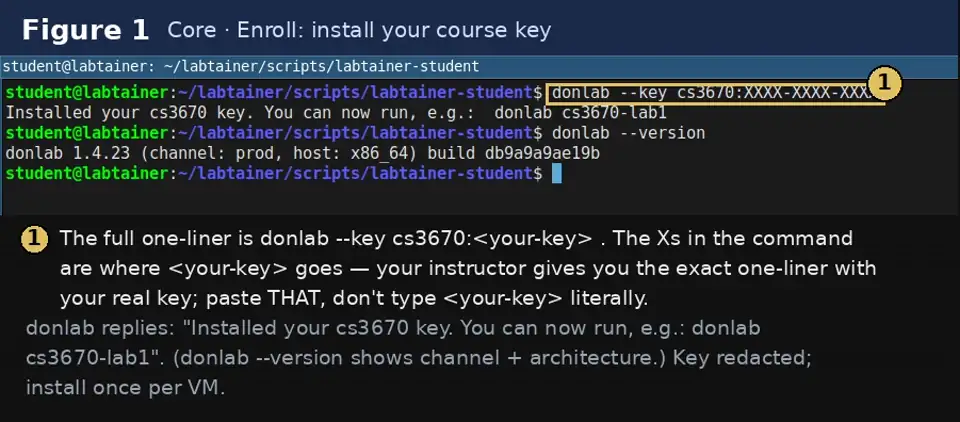

### 6.3 Set up the VM once: `donlab --init`

Run this once after the key is installed. It prepares the lab environment (tmux, vim, flameshot,
Firefox, the **i3** tiling desktop, cgroup v2 if needed), asks once for the **e-mail** the
framework records, and **reboots the VM once**; after the reboot an i3 quick-start window opens
and runs `donlab --check`. It also puts `donlab` on your
PATH, so `donlab <lab>` then works from any directory (this guide keeps the `./donlab` form, which
works from the workspace directory).

```bash
./donlab --init
```

### 6.4 Check the VM is ready

```bash
./donlab --doctor      # --check is the same command
```

It checks Docker, the X display, the desktop/clipboard, Docker Hub reachability, disk/RAM/CPU,
and that `vim`, `tmux` and `flameshot` are present. **Green `PASS`** means ready; yellow `WARN` is
advisory (a small CPU just means builds are slower). **A red `FAIL` blocks a lab — fix it (or ask
your instructor) before continuing.**

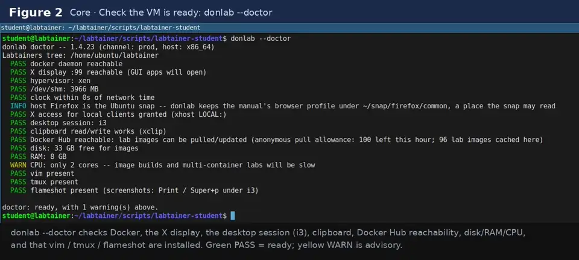

### 6.5 Start a lab

```bash
./donlab cs3670-lab1
```

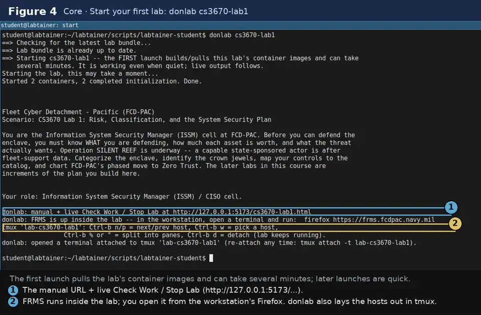

In order, it self-updates, syncs your course's lab bundle (using your key), pulls any changed
images, runs `labtainer <lab>`, opens the manual in Firefox, and lays the hosts out in tmux. The
**first** start of a lab pulls that lab's images and can take several minutes. If you did not give
it during `--init`, the framework asks for your e-mail the first time a lab runs — use the address
your instructor specifies; it becomes part of your submission file name.

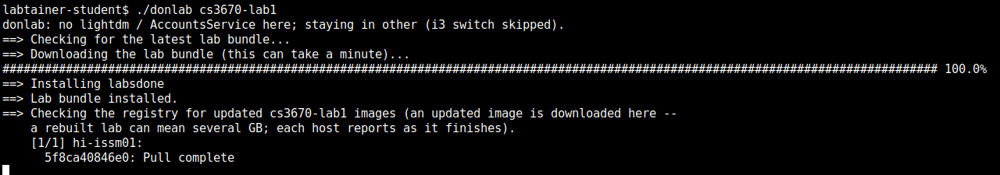
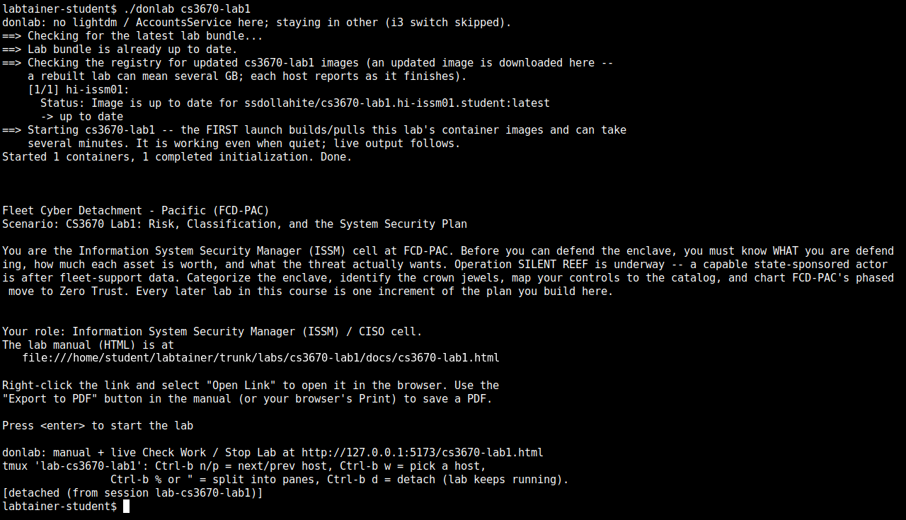

You land in the **i3** desktop: your terminal (a tmux session logged into the lab host) on the
left, the lab manual on the right.

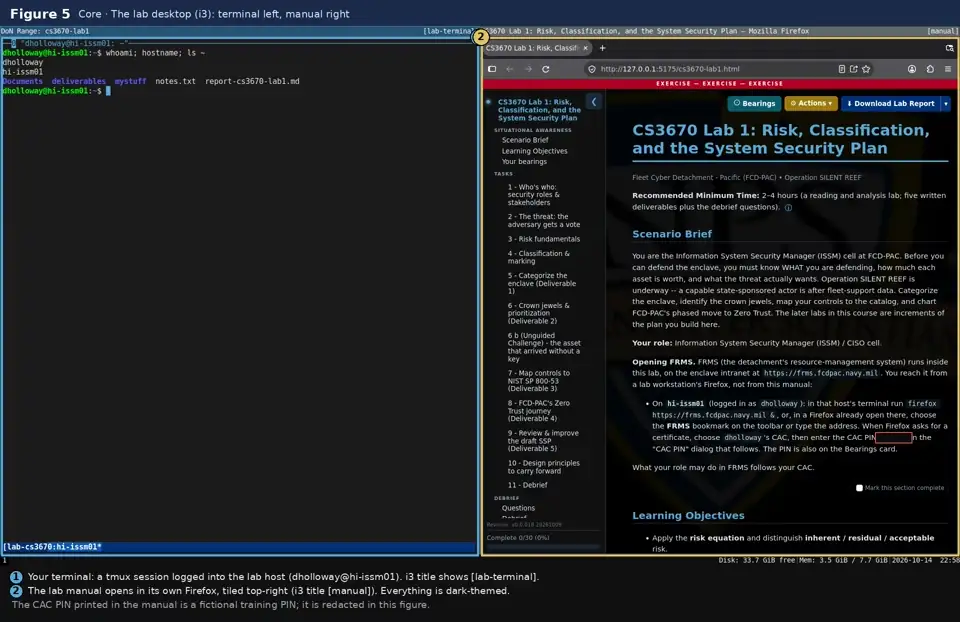

### 6.6 i3, the window manager

i3 tiles windows side by side (no overlapping windows to hunt for). **Super** is the Windows / ⌘
Command key. `Super`+arrows move focus; `Super`+`Shift`+arrows move a window; `Super`+`Enter` a
new terminal; `Super`+`p` or `Print` a screenshot.

`Super`+`f` fullscreens the focused window and back:

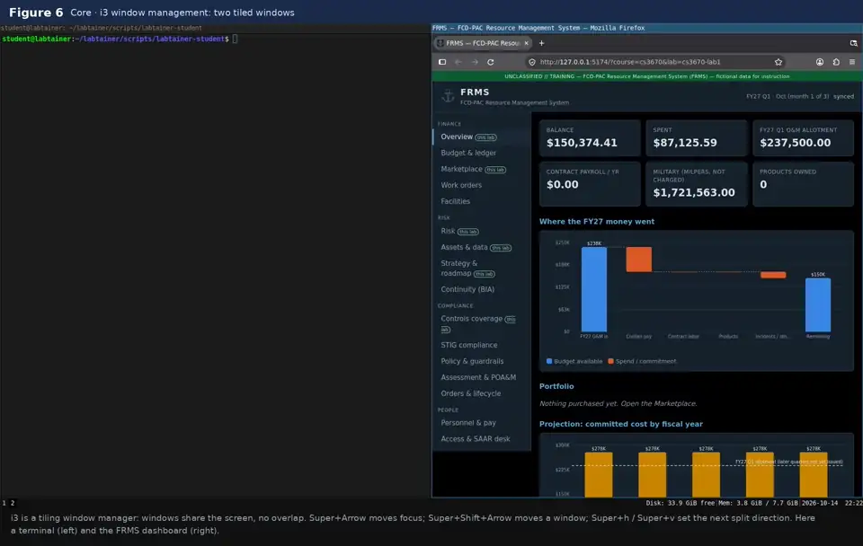

`Super`+`Shift`+`1`..`4` sends a window to workspace 1–4; `Super`+`1`..`4` switches to it:


### 6.7 tmux, your terminals

The lab's hosts are laid out in one tmux session (one window per host). The prefix is `Ctrl-b`;
everything is vi-keyed and the editor is **vim**. `Ctrl-b d` detaches (the lab keeps running);
`Ctrl-b n`/`p` step between hosts, `Ctrl-b w` lists them.

`Ctrl-b %` / `Ctrl-b "` split a window into panes (each a shell in the same host):

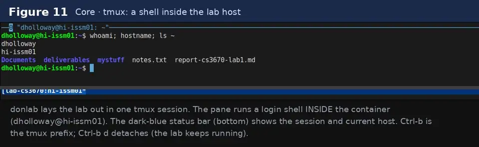

`Ctrl-b [` enters vi copy-mode (scroll/search with `h j k l`, `/`, `?`):

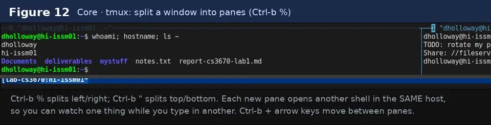

In a multi-host lab each host is its own window:

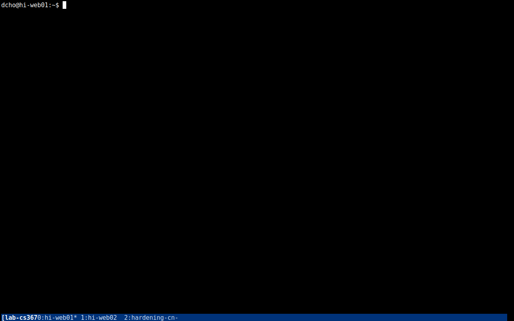

Prefer the framework's pop-up terminal windows? Run `./donlab <lab> --no-tmux`.

### 6.8 The manual and its features

Firefox opens the manual. The sidebar tracks progress; the top bar has **Bearings**, **Actions**,
and **Download Lab Report**.

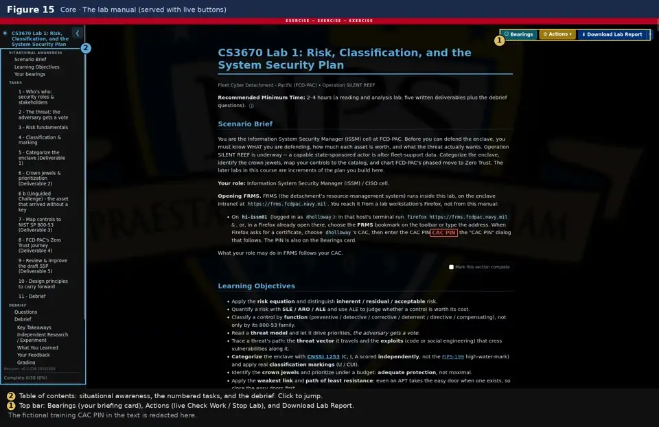

**Writeboxes, the self-check, and progress — three separate things:**

- A **writebox** holds your answer; it **autosaves** to the browser and is collected into your Lab
  Report.
- **"Check my answer"** (on some questions) is a local self-check — the **first click locks** that
  answer and shows feedback like "Looks right". It does not grade or submit; grading is the
  **`checkwork`** button (Actions menu) or `checkwork` in the terminal.
- The **progress bar** advances when you tick **"Mark this section complete"** on a section.

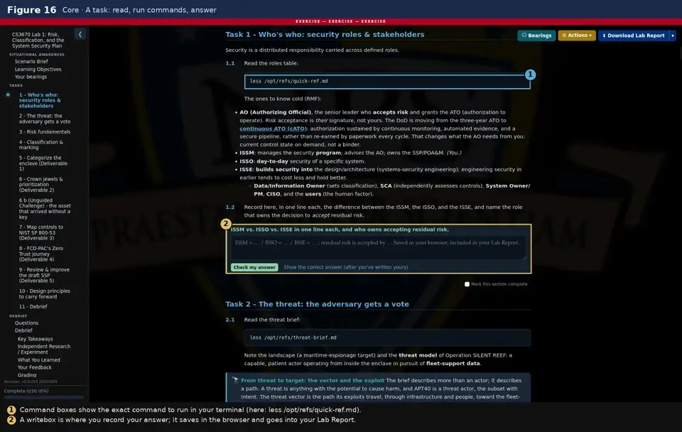

Hover a dotted-underlined term for a **glossary** popover (the owner definition first, with
authoritative sources):

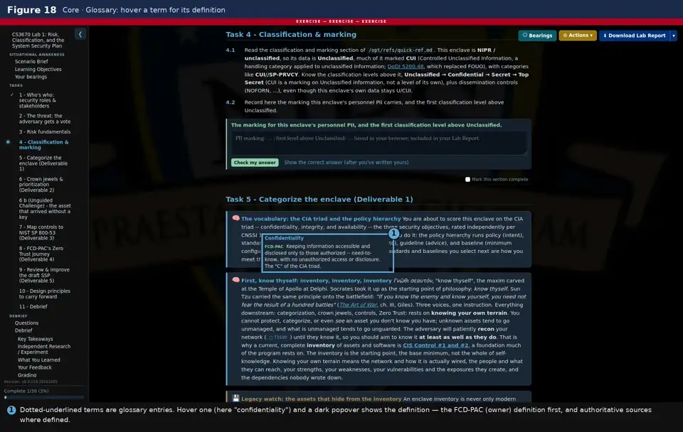

**Bearings** is your briefing card: who you are on each host, and the CAC PIN for FRMS (training
values). In CS3670 Lab 1, FRMS runs inside the lab — open it from the workstation's Firefox and
sign in with your CAC.

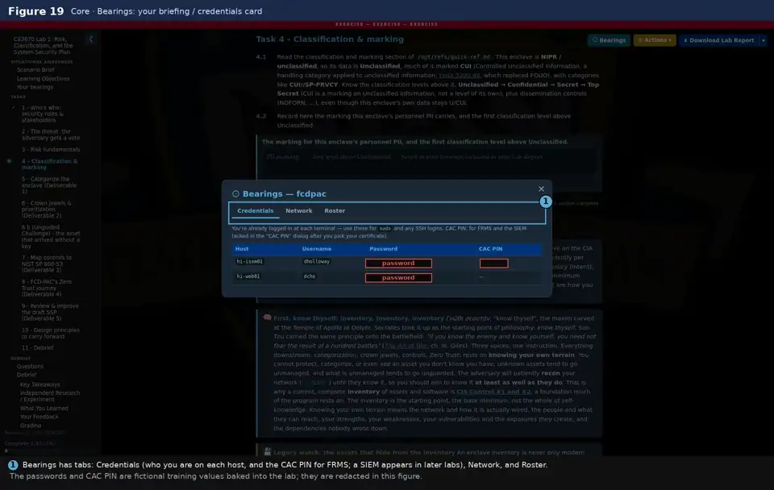

**Actions** runs **`checkwork`**, **`stoplab`** and **Reset Lab** against the running lab:

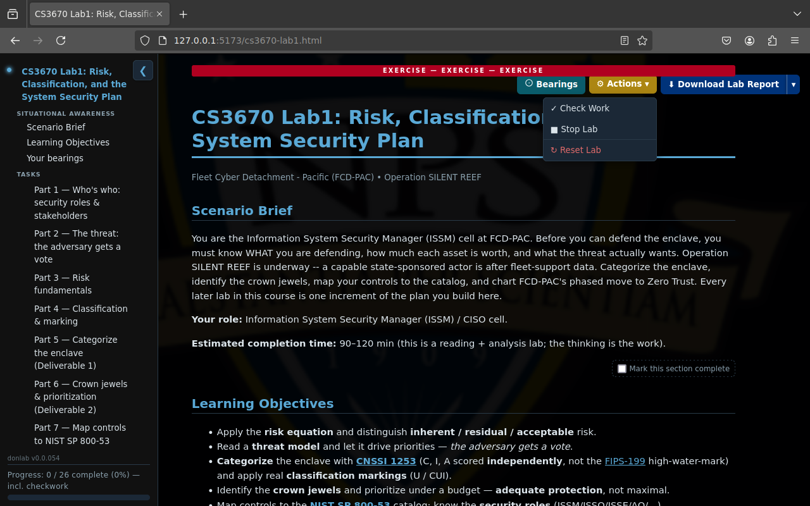

### 6.9 Finish, export the Lab Report, and submit

**Download Lab Report → Finish & build report STOPS the lab**: it runs `checkwork`, then `stoplab`
(which stops the lab and packages your `.lab` submission), then builds and downloads the report.
While still working, use **"Just download a draft"**. The report is **dark-themed in all cases,
including Save / Print to PDF**.

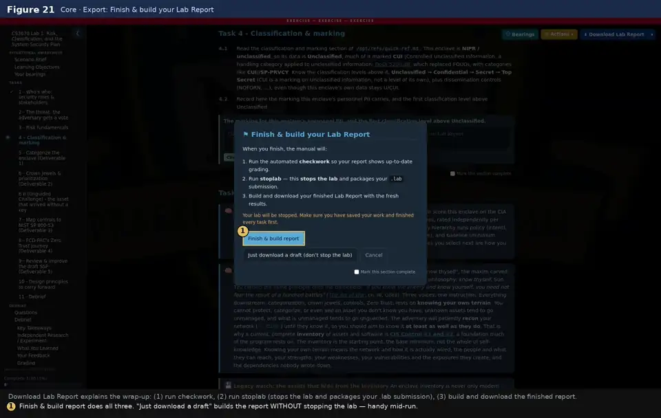

You can also stop from the terminal:

```bash
stoplab cs3670-lab1
```

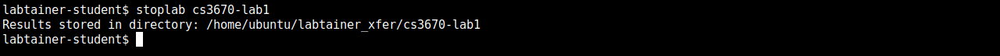

`stoplab` writes your submission — a `.lab` file — under `~/labtainer_xfer/<lab>/`:

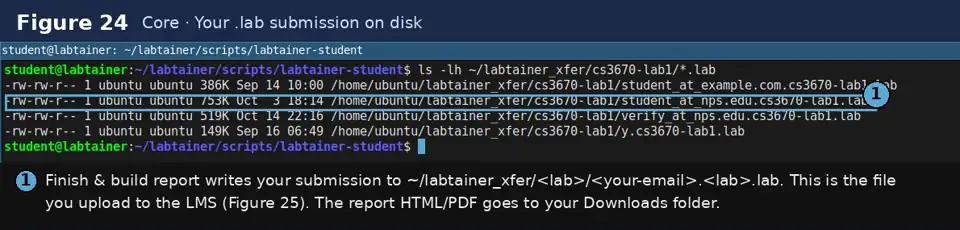

**Submit to the LMS:** upload the **`.lab` archive** and the **Lab Report PDF** to the
assignment, unless your instructor says otherwise. If the LMS rejects the `.lab` for size or
extension, upload the PDF and send the `.lab` by the route your instructor gives. Re-running
`./donlab <lab>` resumes where you left off; `checkwork <lab>` shows live grading;
`./donlab --reset <lab>` discards and restarts (also clearing any leftover Docker network).

### 6.10 Other launcher commands

| Command | Effect |
|---|---|
| `./donlab --key <course>:<key>` | Install your key for a course (`cs3600`/`cs3670`/`cs3690`). |
| `./donlab --doctor` | Readiness check (Docker, display, clipboard, registry, disk, vim, tmux). |
| `./donlab -v` | Launcher version, channel, build id. |
| `./donlab -u` | Force a self-update check now. |
| `./donlab --update-labtainers` | Run the NPS `update-labtainer.sh` framework updater. |
| `./donlab --reset <lab>` | Discard the lab's containers and networks, then start fresh. |
| `./donlab --clean` | Free disk: old images, stopped containers, build cache, temp copies (leaves running labs, installed images, and `~/labtainer_xfer`). |
| `./donlab -h` | Usage text. |
| `DONLAB_NO_PULL=1 ./donlab <lab>` | Skip the image-registry check for this run. |

Do not run more than one lab at a time; results are unreliable when labs overlap.

---

## 7. Troubleshooting / FAQ

If an answer below does not resolve it, spend 5–15 minutes searching or asking an AI assistant,
then contact your instructor rather than continuing to struggle.

**Copy/paste between your computer and the VM should just work.** If it does not, check your
hypervisor's **shared-clipboard** setting (VirtualBox: *Devices → Shared Clipboard →
Bidirectional*; UTM/VMware have the equivalent). In a terminal, paste is often **Ctrl+Shift+V**.
If paste still fails, open the LMS from the browser **inside the VM** and upload from there.

**No network in the VM / a Docker Hub `WARN` in `donlab --doctor`.** The self-update and bundle
check are skipped and the lab starts from what is installed. The **first** start of a lab needs a
network to pull its images; after that they are cached and later launches work offline. Retry on
a better network. (UTM: a VM that shows `Network is unreachable` after the Mac slept needs a
shutdown and restart; keep the network at Emulated VLAN.)

**The VM rebooted during the first run.** Expected — the one-time i3 setup (and, on an older
appliance, the cgroup v2 conversion). Log in again and re-run `./donlab <lab>`.

**"You need your course key" / `WARN: decrypt failed`.** The course key is missing or wrong.
Install it with `donlab --key <course>:<key>` and run the lab again.

**A lab update renamed or added hosts and the start fails.** The launcher prunes stale per-lab
files each run; if a start still fails, `stoplab <lab>` then start again.

**`Already exists` or a leftover network.** The launcher stops the leftover, removes the blocking
Docker network and retries once. If it still fails it prints each non-running container's last log
lines; run `stoplab <lab>`, then `./donlab <lab>` (or `./donlab --reset <lab>`).

**Firefox or Wireshark inside a lab does not open.** GUI programs display on the VM's desktop, so
run the launcher from a terminal in the desktop session, not over SSH. `./donlab --doctor` reports
whether the display and clipboard are reachable. (Windows/VirtualBox: see the Display settings in
[section 4.3](#43-import-the-appliance).)

**The manual's `checkwork` / `stoplab` buttons do nothing.** They need the local helper the
launcher starts, and work only in the Firefox on the same VM as the lab. Run `checkwork <lab>` or
`stoplab <lab>` in the terminal instead.

**Where is everything?** Labs run from `$LABTAINER_DIR/scripts/labtainer-student`. Lab definitions
and manuals are under `$LABTAINER_DIR/labs/<lab>/` (`docs/<lab>.html`). Submissions are under
`~/labtainer_xfer/<lab>/`. Launcher state is under `~/.config/don-range/`.

**My problem is not listed.** For framework issues see the
[Labtainers Student Guide](https://github.com/mfthomps/Labtainers/raw/master/docs/student/labtainer-student.pdf)
and the NPS [support page](https://nps.edu/web/c3o/support1). For anything about the DoN Range labs
or the launcher, contact your instructor.

---

## 8. Lab ids and next steps

Start a lab with `donlab <lab-id>`. The lab ids follow `csNNNN-labN`, for example:

- **CS3600:** `cs3600-lab0` … `cs3600-lab9`
- **CS3670:** `cs3670-lab1` … `cs3670-lab11`
- **CS3690:** `cs3690-lab0` … `cs3690-lab11`

Install the matching course key first ([section 6.2](#62-install-your-course-key)); the exact labs
assigned, and their order, come from your instructor. `donlab` with no lab id, or `labtainer`
with no arguments, lists the labs installed on your VM.

**Other options.** On hardware that cannot meet the specs, the
[Student Guide](https://github.com/mfthomps/Labtainers/raw/master/docs/student/labtainer-student.pdf)
("Cloud Labtainers") runs Labtainers in a browser. The interactive and video versions of this
guide are in [`tutorial/`](tutorial/) (`tutorial/index.html`, `tutorial/vid.html`).
