# DoN Range — Zero-to-Lab Onboarding Tutorial

**From nothing to running your first lab (CS3670 Lab 1) and using it.**

This walkthrough is also the storyboard for the onboarding video (see `STORYBOARD.md`). It has two
halves: a **setup preamble** that differs by computer, and a shared **Core** that is the same for
everyone.

---

## Before you start

**From your instructor, have these ready:**
- The **appliance download**: for **x86-64** machines, the official **NPS virtual-machine-images
  (downloads) page**; for an **Apple-Silicon Mac**, the **OneDrive folder** (it holds both an arm64
  `.ova` and a `.utm.zip`).
- Your **VM login** (the student account inside the appliance).
- Your **`cs3670` course key** (unlocks this course's labs; you install it once).

**Host specs:**

| Resource | Minimum | Recommended |
|---|---|---|
| Host OS | 64-bit Windows 10/11, macOS, or Linux (current release) | — |
| Host RAM | 16 GB (the VM uses 8 GB) | 16 GB+ (scales with what you allot the guest) |
| Guest RAM | 8 GB | 8 GB+ (raise it only if your host can spare it) |
| Guest vCPU | 2 | 4+ (more if you have the cores) |
| Free host disk | ~80 GB | ~120 GB+ |

The "+" means *this or more, as long as you don't starve the host OS*. Give the guest more vCPU/RAM
only without robbing the host of what it needs. The guest ships at **8 GB RAM / 60 GB virtual disk**
(the disk grows as labs run and pull images; the ~5 GB download and import need headroom). On
**Intel/AMD PCs and Intel Macs**, enable **CPU virtualization** (VT-x / AMD-V) in BIOS/UEFI (usually on
by default); **Apple-Silicon Macs need no such setting.**

These numbers are a general baseline, not a one-size-fits-all guarantee; they will not be ideal for
every hardware and hypervisor combination. Feel free to adjust the VM's vCPU, RAM and disk, and other
hypervisor settings — display/graphics in particular, along with clipboard and networking — to suit
your machine and smooth out performance. There are too many combinations to list here, so it is worth
experimenting a little and doing some of your own research to settle on a good setup.

**Which hypervisor?** Native-first: run the appliance that **matches your machine's CPU**, virtualized
natively.

| Your machine | Hypervisors | Appliance (source) |
|---|---|---|
| Windows / Linux PC (x86-64) | **VirtualBox** or **VMware Workstation** | x86_64 `.ova` — **NPS page** |
| **Intel Mac** (x86-64, native) | **VirtualBox** or **VMware Fusion** | x86_64 `.ova` — **NPS page** |
| Apple-Silicon Mac (arm64) | **VirtualBox (preferred)**, **VMware Fusion**, or **UTM** | arm64 `.ova` (VirtualBox / Fusion) or `.utm.zip` (UTM) — **OneDrive** |

VirtualBox and UTM need **no account**. **VMware** Workstation (Windows/Linux) and Fusion (Mac) are
free but require a **Broadcom account** to download; the appliance imports the same way. On
**Apple Silicon, VirtualBox is the recommended choice.**

> **Emulation is a last resort.** Emulation means running a **non-native** guest — for example the
> x86_64 appliance on an Apple-Silicon Mac. It is noticeably **slow**. Use it only if a native
> appliance for your machine genuinely is not an option.

---

# Do ONE of Setup A or Setup B, then everyone does [Core](#core-every-platform).

- **Windows / Linux / Intel-Mac (x86-64):** do **[Setup A](#setup-a)**.
  *(On a Mac with Apple Silicon, skip to [Setup B](#setup-b).)*
- **Apple-Silicon Mac (arm64):** do **[Setup B](#setup-b)**.

---

<a id="setup-a"></a>
## Setup A — Windows / Linux / Intel-Mac (x86-64): VirtualBox (or VMware) + the NPS appliance

> Use this if your computer has an **Intel or AMD (x86-64)** processor — any Windows PC, Linux PC,
> or **Intel Mac**. An Intel Mac runs the x86_64 appliance **natively** (not emulated).

### A1. Install your hypervisor
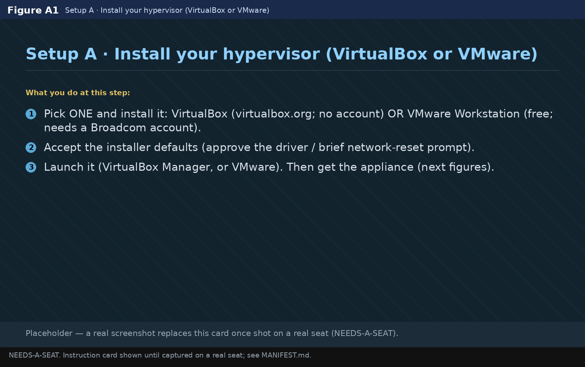

Pick one and install it: **VirtualBox** (virtualbox.org; no account) or **VMware Workstation** (free;
needs a Broadcom account). Accept the installer defaults (approve the driver / brief network-reset
prompt), then launch it. Both import the `.ova` the same way.

### A1b. Download the appliance (from the NPS downloads page)


Open the official **NPS Labtainers virtual-machine-images (downloads) page** and download the
**x86_64 appliance `.ova`** for your hypervisor (VirtualBox and VMware both use the `.ova`). It is
**several GB** — allow time and do **not** cancel. The `.ova` is a single file; it imports directly,
no unzip.

### A2–A6. Import the appliance
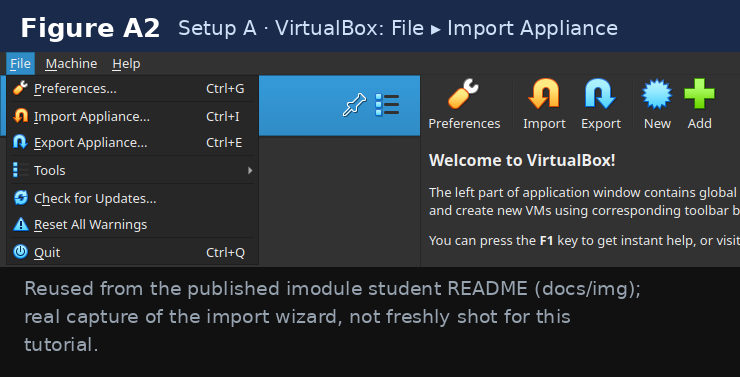
In VirtualBox Manager, choose **File ▸ Import Appliance…** (VMware: **File ▸ Open**).

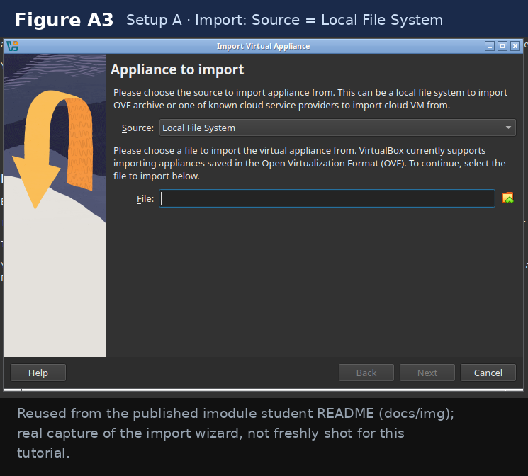
Leave **Source = Local File System**.


Click the folder icon and select the **`.ova`** you downloaded.

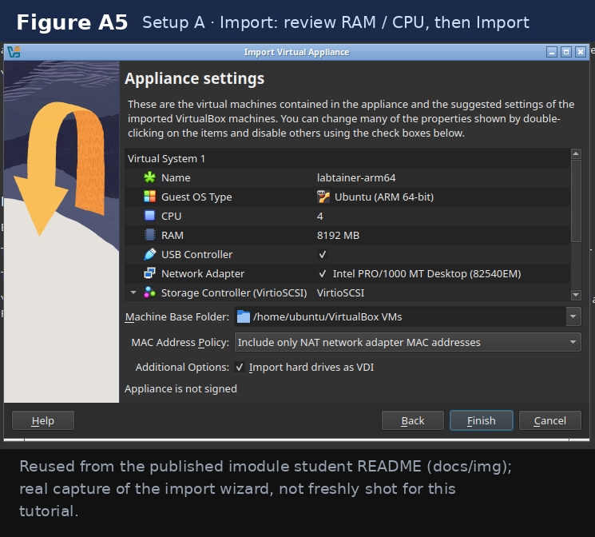
Review the settings. Give the VM as much **RAM (8 GB+)** and **CPU** as you can spare, then
**Import**.

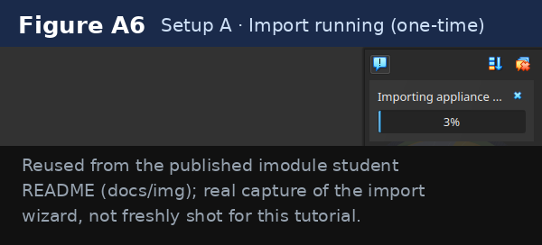
The one-time import runs. When it finishes, the VM appears in the list. Start it.

### A7. First boot and login
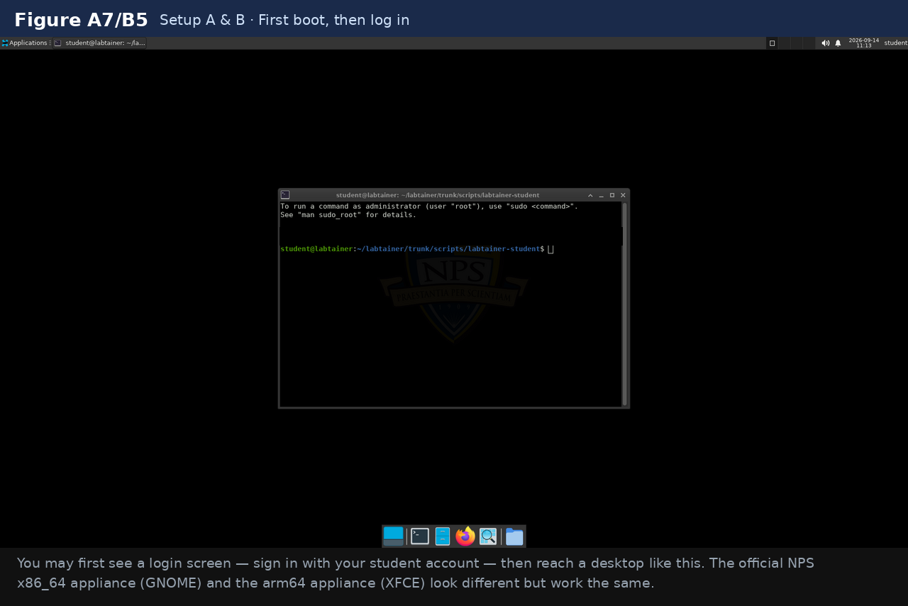
You may first see a login screen. Sign in with your student account, then reach the desktop.
**Now continue with [Core](#core-every-platform).**

---

<a id="setup-b"></a>
## Setup B — Apple-Silicon Mac (arm64): UTM + the arm64 appliance

> Use this if your computer is a **Mac with Apple Silicon** (M1/M2/M3/M4). It runs the **arm64**
> appliance natively via Apple Virtualization.
> *(On a Windows / Linux / Intel-Mac machine, skip to [Setup A](#setup-a).)*

### B1. Install your hypervisor
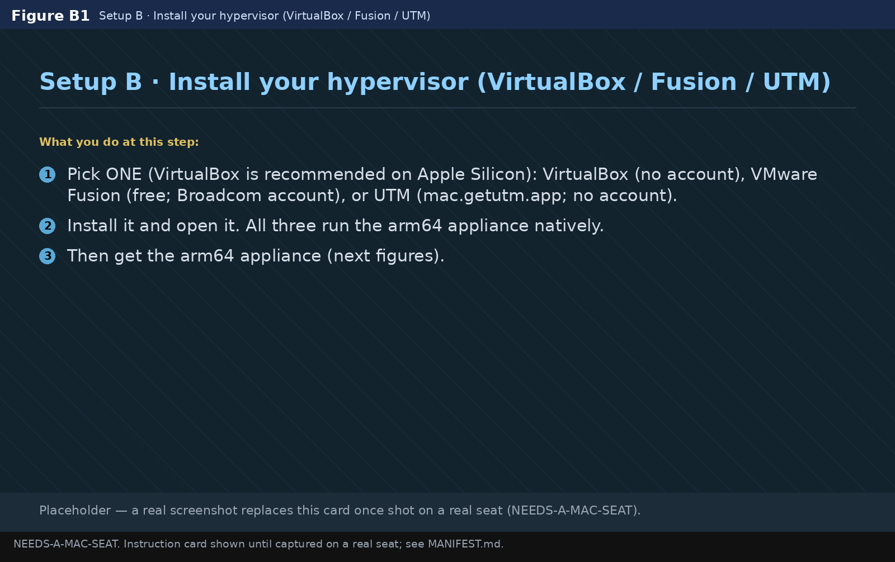

Apple Silicon runs the **arm64** appliance natively on three hypervisors. Pick one and install it:
**VirtualBox** (recommended; no account), **VMware Fusion** (free; Broadcom account), or **UTM**
(mac.getutm.app; no account).

### B1b. Download the appliance (from your instructor's OneDrive)


Open the **OneDrive folder**. It holds the arm64 **`.ova`** and a **`.utm.zip`**:
- **VirtualBox or VMware Fusion:** download the arm64 **`.ova`** (several GB; don't cancel). It imports
  directly, no unzip.
- **UTM:** download the **`.utm.zip`**, then double-click it so macOS Archive Utility extracts the
  `.utm` bundle.

### B2–B4. Import / open the appliance

**VirtualBox or VMware Fusion:** import the `.ova` the same way as Setup A — **File ▸ Import
Appliance** (VMware: **File ▸ Open**), review RAM/CPU, then **Import**. The wizard is identical to
Setup A figures A2–A6.

**UTM:**
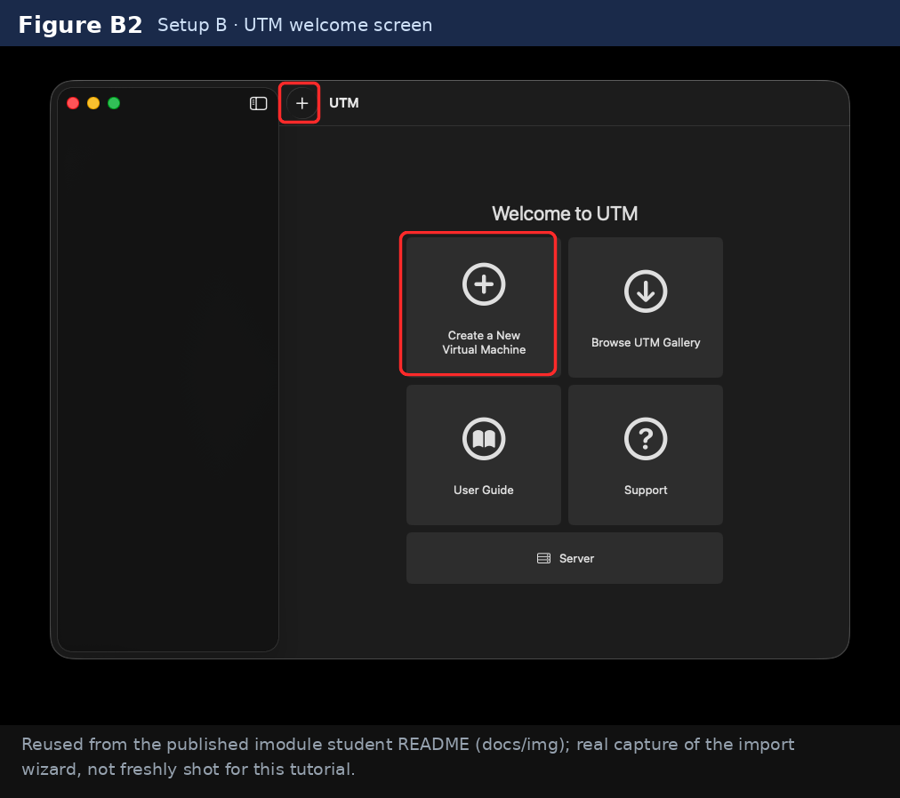
UTM's welcome screen.

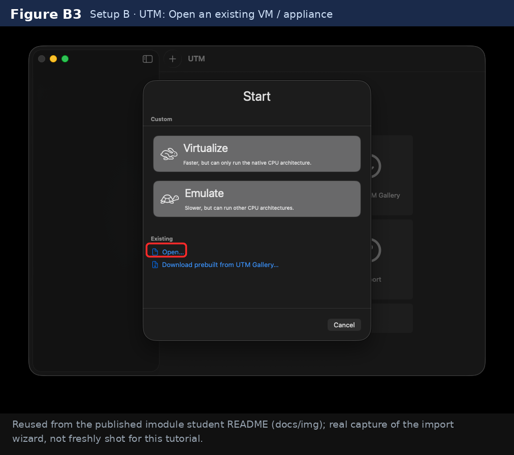
Use **Open…** (or double-click the extracted `.utm`) to add the VM to UTM.

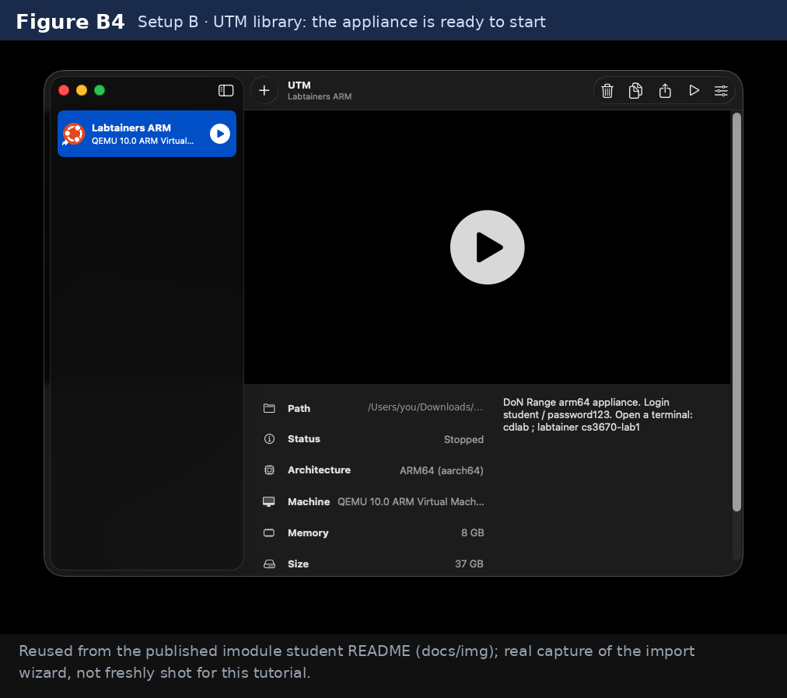
The appliance sits in your UTM library. Select it and press **▶ Start**.

> **UTM networking tip:** if the VM has no internet, set its Network Mode to **Emulated VLAN** in
> UTM's settings (QEMU user-mode NAT/DHCP, independent of the Mac's network state).

### B5. First boot and login

You may first see a login screen. Sign in with your student account, then reach the desktop (the
arm64 appliance uses XFCE; it looks a little different from the x86 one but works the same).
**Now continue with [Core](#core-every-platform).**

---

<a id="core-every-platform"></a>
## Core (every platform)

Everything below is the same whether you came from Setup A or Setup B. The one hidden difference is
that `donlab` pulls the container images that match your CPU (x86-64 or arm64); you type the same
commands either way.

### 1. Enroll: install your course key
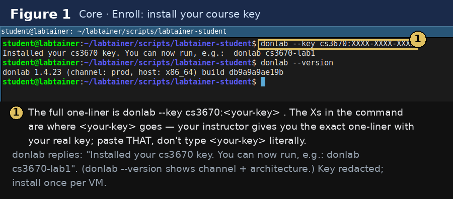

Open a terminal. Install your course key **once** on this VM:

```
donlab --key cs3670:<your-key>
```

Your **course key** unlocks this course's labs. Your instructor gives you the **full one-liner with
your real key** — paste **that**; do not type `<your-key>` literally. (In the screenshot the key is
blanked with Xs; that is where your key goes.) donlab replies:

```
Installed your cs3670 key. You can now run, e.g.:  donlab cs3670-lab1
```

### 2. Check the VM is ready
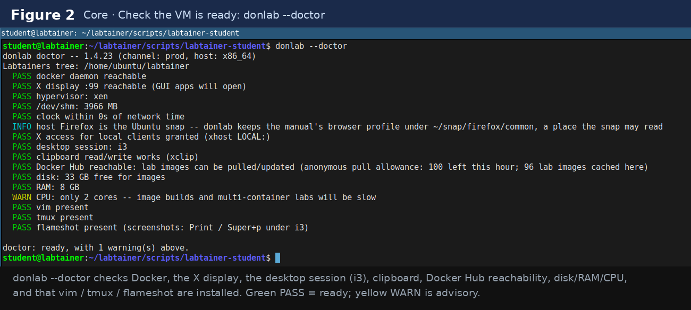

```
donlab --doctor
```

It checks Docker, the display, the i3 session, the clipboard, Docker Hub reachability, disk/RAM/CPU,
and that `vim`, `tmux` and `flameshot` are installed. **Green `PASS`** means you are ready; yellow
`WARN` is advisory (a small CPU just means builds are slower). On **Docker Hub reachability**: a
`WARN`/`FAIL` means no network to pull images right now. The first lab launch needs it; after images
are cached, later launches work offline. Retry on a better network.

### 3. The donlab commands
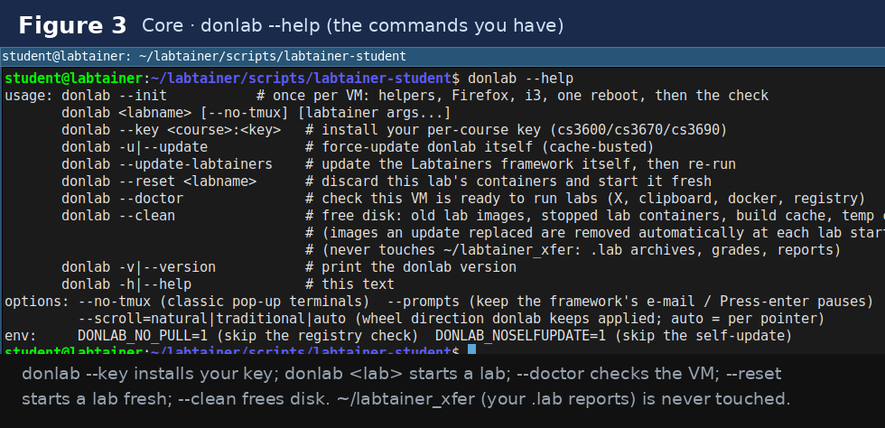

`donlab --help` lists what you have: `--key` (enroll), `donlab <lab>` (start a lab), `--doctor`
(check the VM), `--reset <lab>` (start a lab fresh), `--clean` (free disk). Your submitted reports
under `~/labtainer_xfer` are left alone by `--clean`.

### 4. Start your first lab
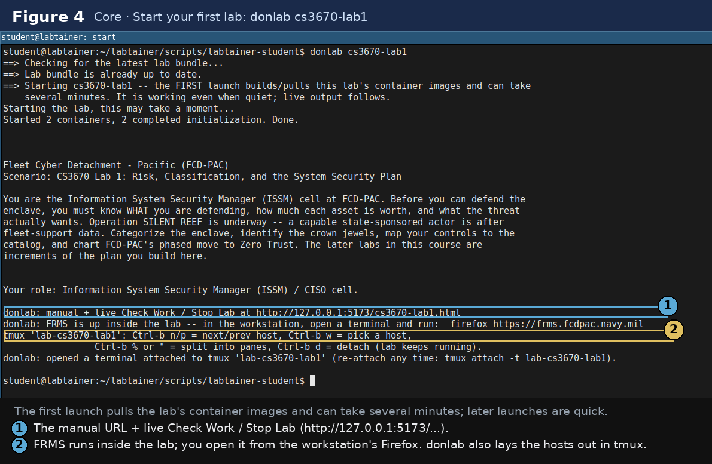

```
donlab cs3670-lab1
```

The **first** launch pulls this lab's container images and can take several minutes; later launches
are quick. Starting a lab drops you into the **i3** desktop (step 5). donlab prints the manual URL,
notes that FRMS is up inside the lab, and lays the hosts out in tmux.

> **Fresh-appliance first run:** the first time, donlab may set up the i3 desktop and **reboot the VM
> once**. Log back in and run `donlab cs3670-lab1` again. You can also run `donlab --init` first to do
> that one-time setup explicitly.

### 5. The lab desktop
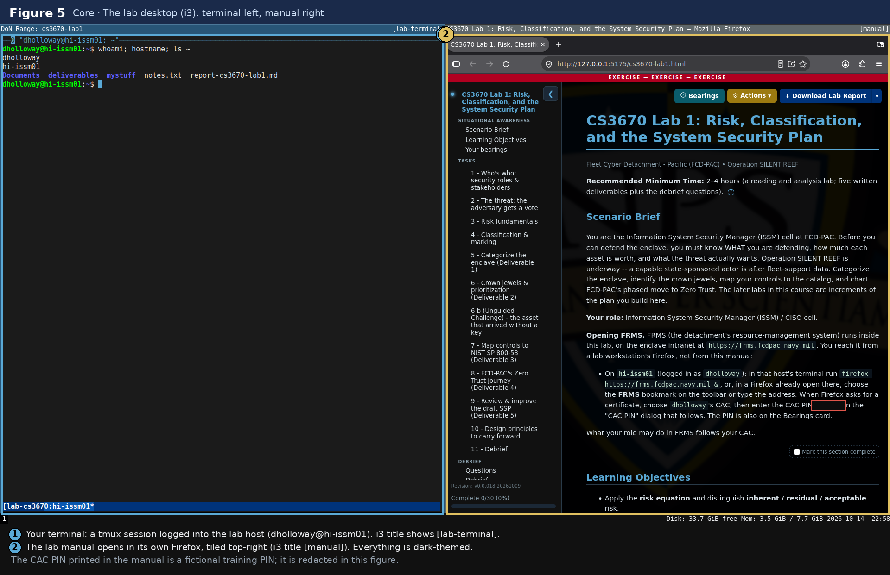

You land in the **i3** tiling desktop, dark-themed: your **terminal** (a tmux session logged into the
lab host) on the left, and the **lab manual** in its own Firefox on the right. Read the Scenario
Brief, then work the tasks top to bottom.

### 6–10. i3, the window manager
i3 tiles windows side by side (no overlapping windows to hunt for). The in-lab i3 tutorial covers the
detail; the essentials:

| Key | Does |
|---|---|
| `Super`+`Enter` | new terminal |
| `Super`+arrows | move focus between windows |
| `Super`+`Shift`+arrows | move the focused window |
| `Super`+`f` | fullscreen the focused window (toggle) |
| `Super`+`1..4` | switch to workspace 1..4 |
| `Super`+`Shift`+`1..4` | send the focused window to that workspace |
| `Super`+`p` or `Print` | screenshot (flameshot → `~/labtainer_xfer/screenshots`) |

**Super** is the Windows / ⌘ Command key.

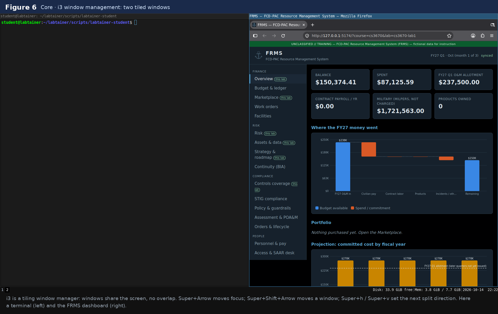
Two tiled windows: a terminal and the FRMS dashboard.

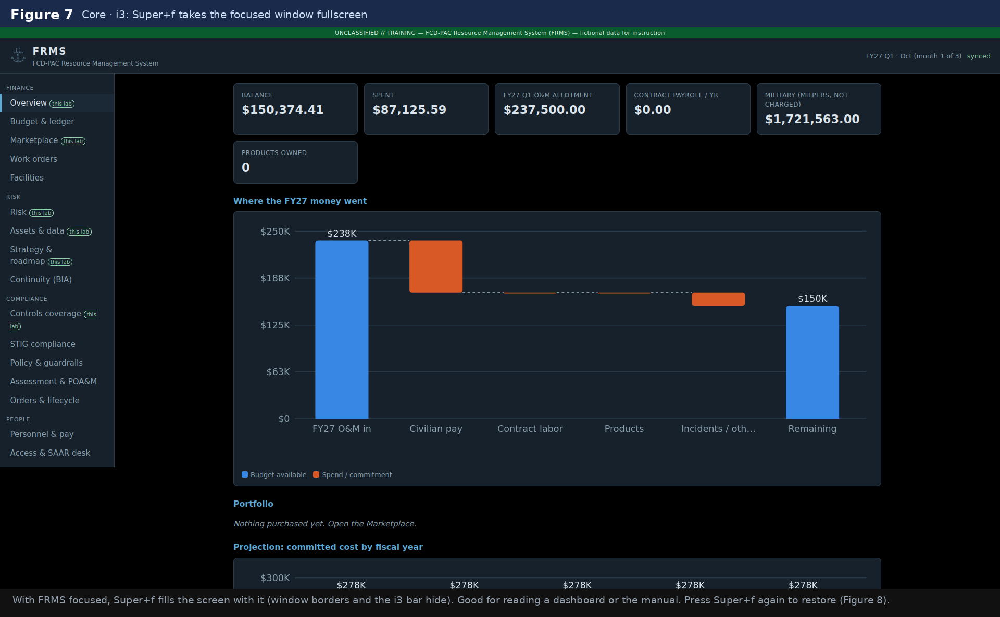
`Super`+`f` takes the focused window fullscreen (borders and the bar hide), good for reading.

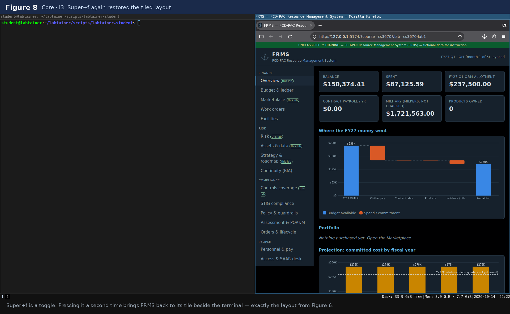
`Super`+`f` again restores the tiled layout.

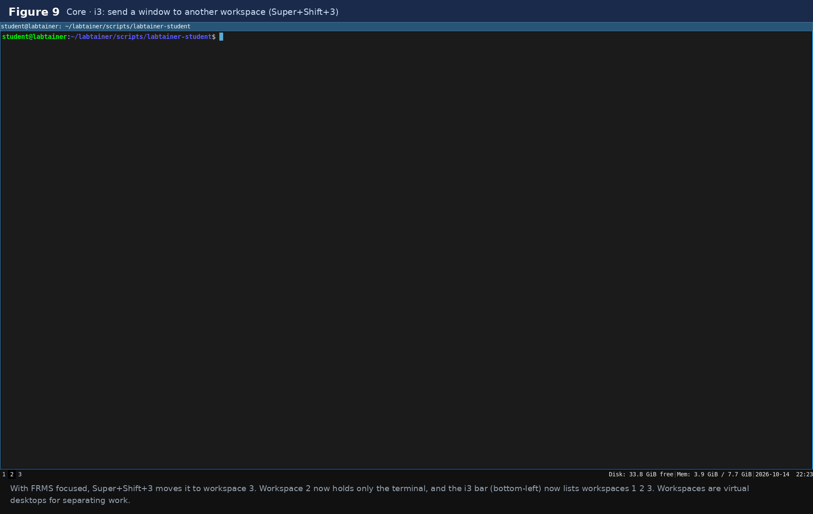
`Super`+`Shift`+`3` sends the focused window to **workspace 3**. The current workspace keeps only the
terminal; the i3 bar (bottom-left) now lists `1 2 3`.

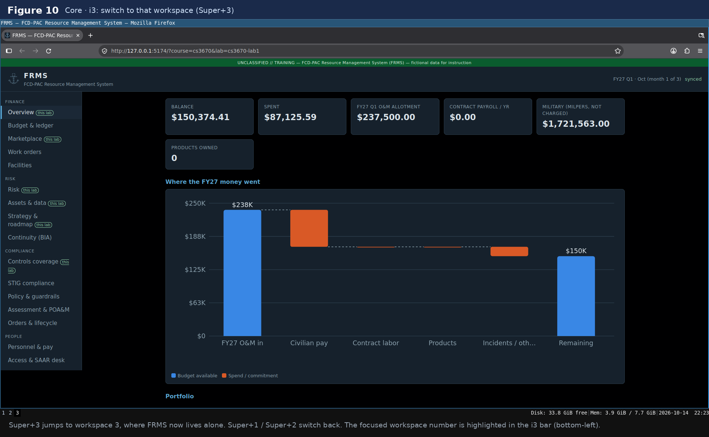
`Super`+`3` switches to workspace 3, where that window now lives alone. `Super`+`1` returns.
Workspaces are virtual desktops, handy for separating the manual from your work.

▶ **See it move:**  

### 11–14. tmux, your terminals
donlab arranges the lab's hosts in one **tmux** session. The prefix key is **`Ctrl-b`**. The
environment is vi-keyed, and the editor everywhere is **vim**.

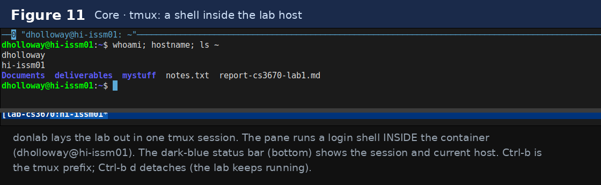
The pane is a shell **inside** the lab host (`dholloway@hi-issm01`). The dark-blue status bar names
the session and host. `Ctrl-b d` detaches (the lab keeps running); `tmux attach -t lab-cs3670-lab1`
returns.

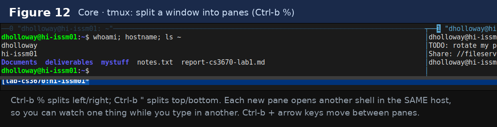
`Ctrl-b %` splits left/right, `Ctrl-b "` splits top/bottom; each pane is another shell in the same
host. `Ctrl-b` + arrows moves between panes.

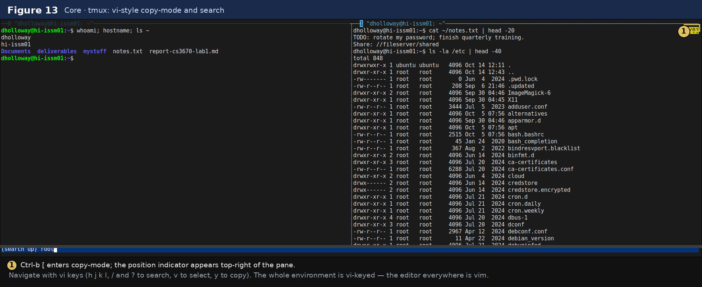
`Ctrl-b [` enters copy-mode; navigate and search with **vi keys** (`h j k l`, `/` and `?`, `v`
select, `y` copy). `q` or `Esc` leaves copy-mode.

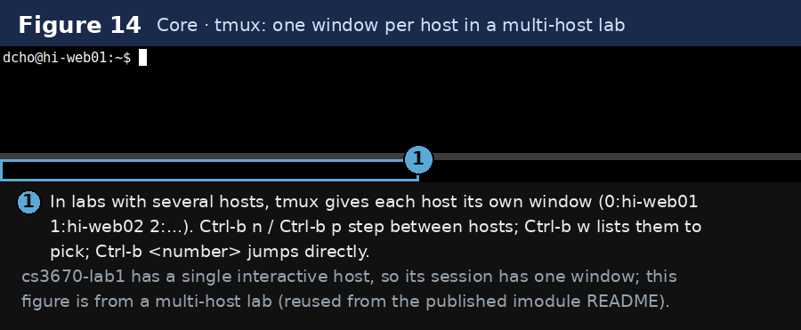
In a multi-host lab, each host gets its own tmux **window**: `Ctrl-b n`/`Ctrl-b p` step between them,
`Ctrl-b w` lists them, `Ctrl-b <number>` jumps. (CS3670 Lab 1 has one interactive host, so one
window.)

▶ **See it move:** 

### 15–20. The manual and its features
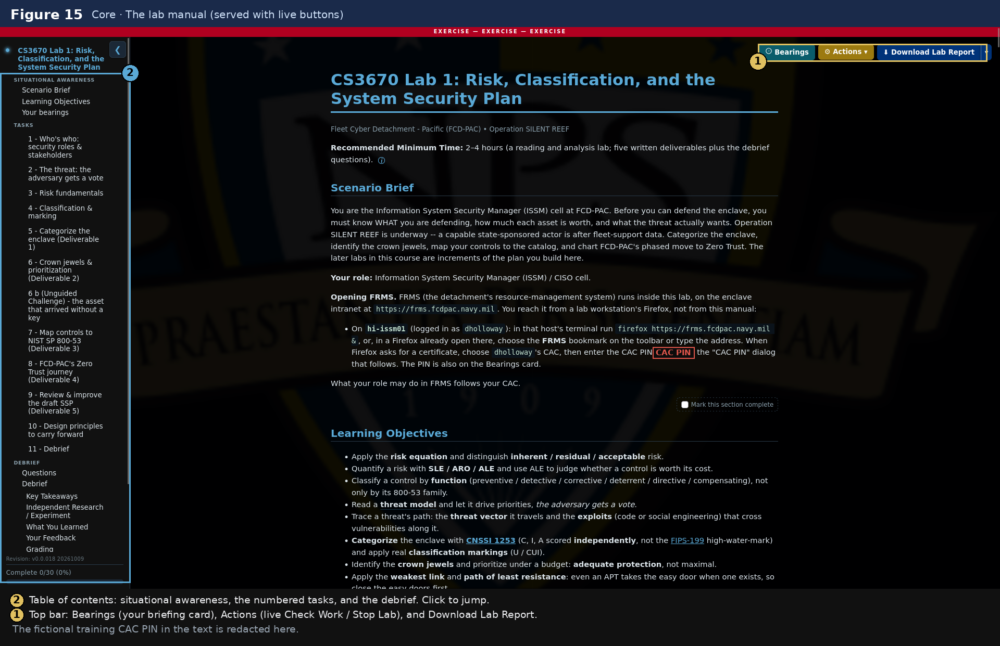
The manual has a table of contents (situational awareness, the numbered tasks, the debrief) and a top
bar: **Bearings** (your briefing card), **Actions** (live Check Work / Stop Lab), and **Download Lab
Report**.

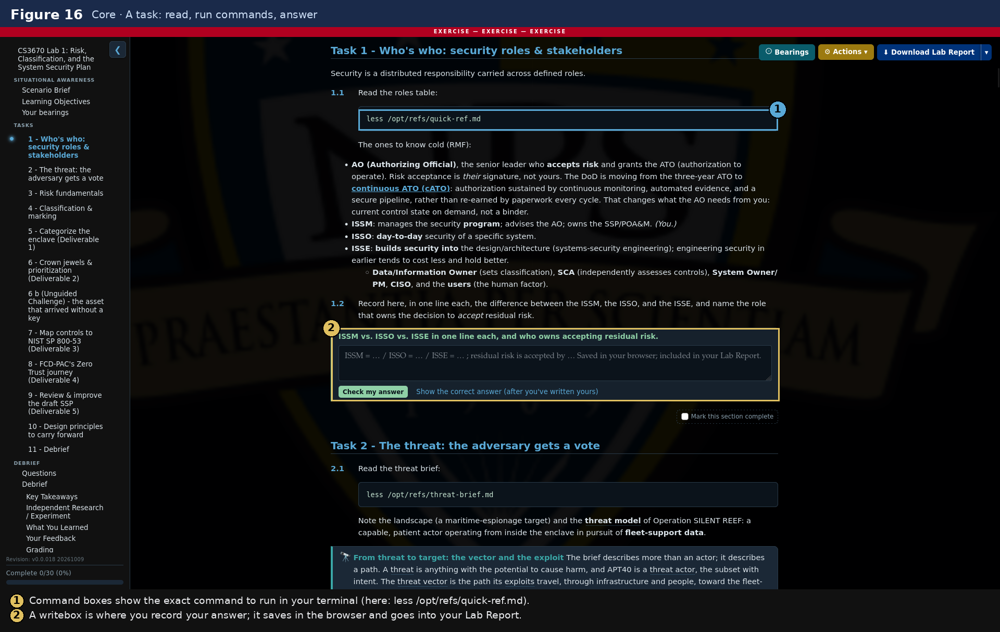
Each task mixes reading, **command boxes** (the exact command to run in your terminal), and
**writeboxes** for your answers.

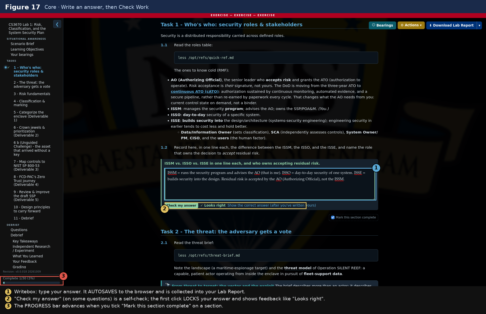
Three separate things happen here:
- **Writeboxes save your answers.** Type into a writebox; it **autosaves** to the browser and is
  collected into your Lab Report.
- **"Check my answer"** appears on some questions. It is a self-check; the **first click locks your
  answer** and shows feedback such as "Looks right".
- **The progress bar** advances when you tick **"Mark this section complete"** on a section.

▶ **See it move:** 

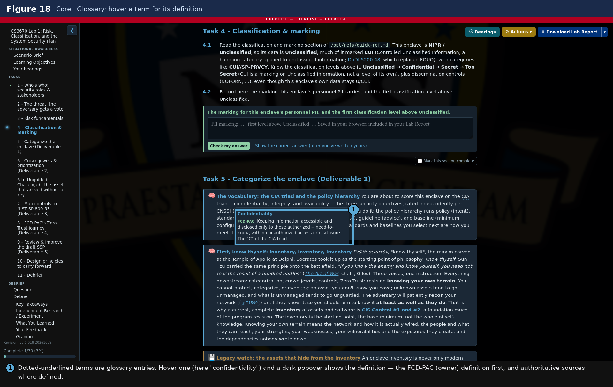
Hover a dotted-underlined term for a **glossary** popover: the FCD-PAC (owner) definition first, with
authoritative sources where defined.

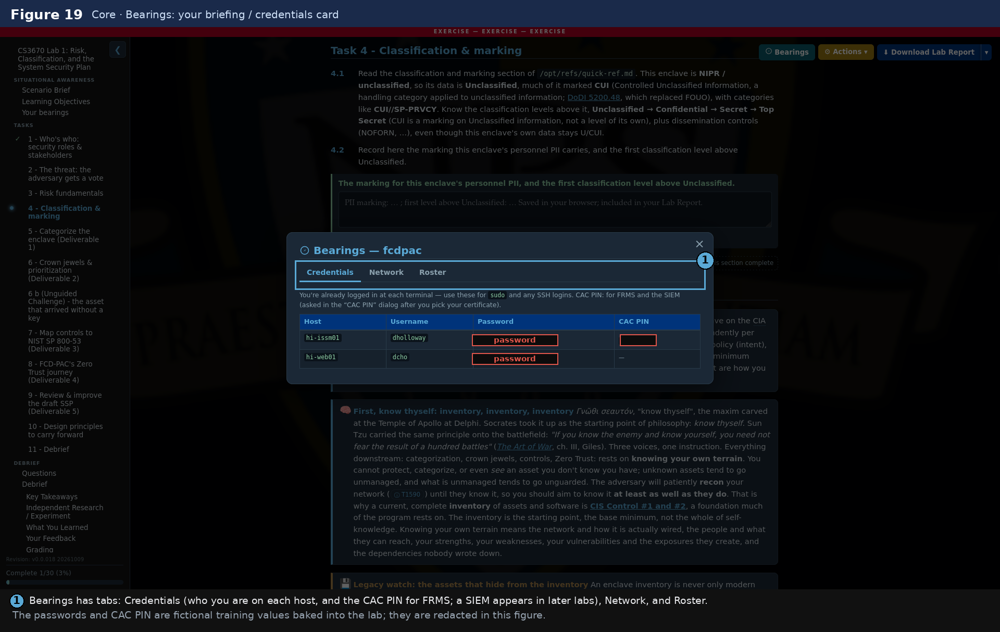
**Bearings** is your briefing card: who you are on each host and the CAC PIN for FRMS (a SIEM appears
in later labs), plus Network and Roster. *(Passwords and the CAC PIN are fictional training values,
redacted in this figure.)* In CS3670 Lab 1, FRMS runs **inside** the lab: open it from the
workstation's Firefox at `https://frms.fcdpac.navy.mil` and sign in with your CAC. Its budget,
marketplace and personnel data feed your deliverables (Figures 6–10 show the FRMS dashboard).

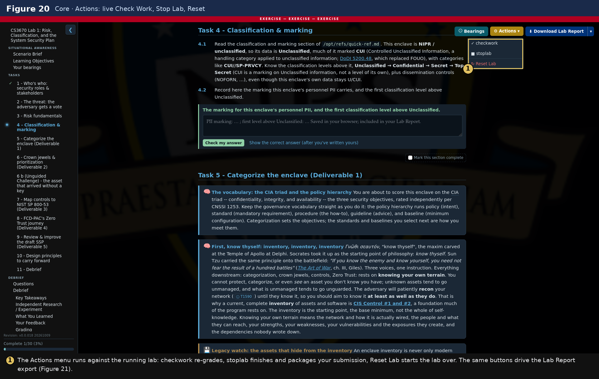
The **Actions** menu runs against the live lab: `checkwork` re-grades, `stoplab` finishes and packages
your submission, `Reset Lab` starts over.

### 21–24. Finish and export your Lab Report
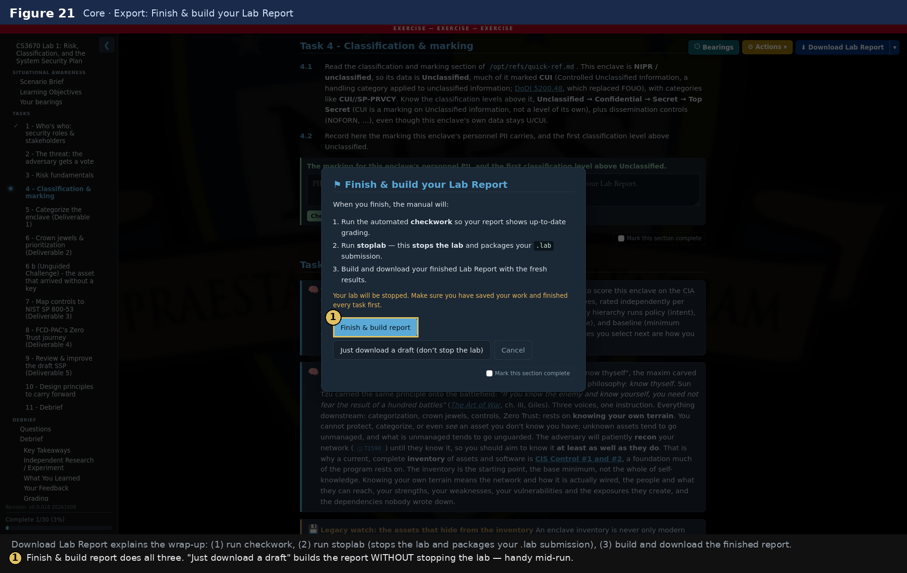
**Download Lab Report ▸ Finish & build report STOPS the lab.** It (1) runs Check Work, (2) runs
`stoplab`, which **stops the lab and packages your `.lab` submission**, then (3) builds and downloads
your finished report. Do this when you are done. While you are **still working**, use **"Just download
a draft"**, which builds the report without stopping the lab.

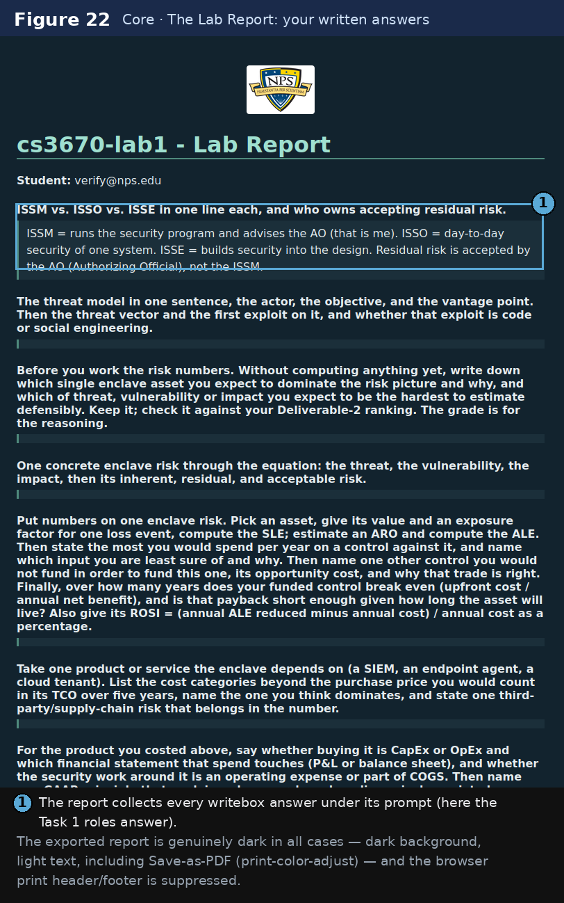
The Lab Report collects every writebox answer under its prompt. It is **dark-themed in all cases**,
including **Save / Print to PDF** (`print-color-adjust`), with the browser's print header/footer
suppressed. Use Print / Save as PDF to keep a copy.

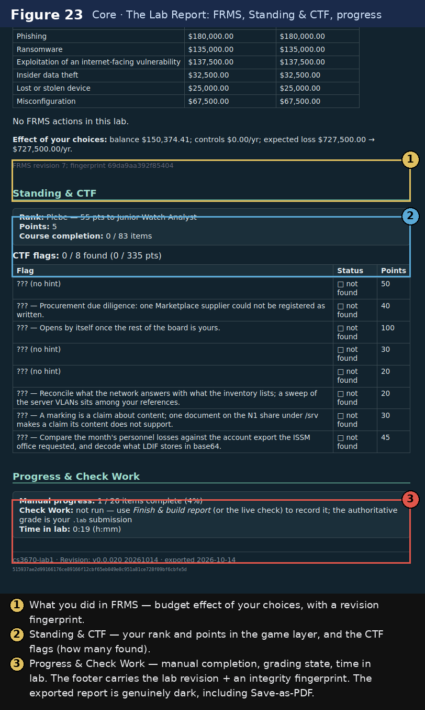
Further down: **what you did in FRMS** (budget effect, with a fingerprint), **Standing & CTF** (your
rank and points in the game layer, and CTF flags found), and **Progress & Check Work** (manual
completion, grading state, time in lab). The footer carries the lab revision and an integrity
fingerprint.

▶ **See it move:** 

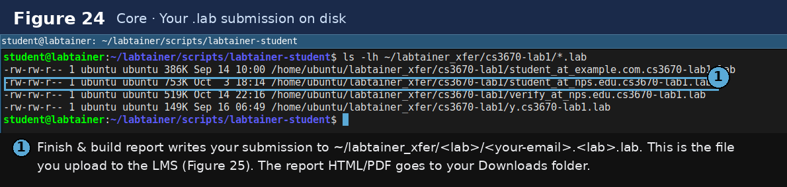
Your submission lands at `~/labtainer_xfer/cs3670-lab1/<your-email>.cs3670-lab1.lab`. That `.lab` file
is what you turn in; the report HTML/PDF goes to your Downloads folder.

### 25. Submit to the LMS
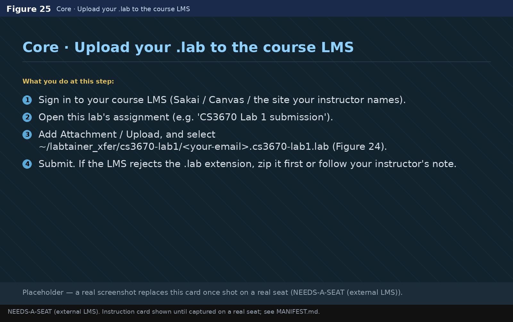
Sign in to your course LMS, open the assignment for this lab, attach
`~/labtainer_xfer/cs3670-lab1/<your-email>.cs3670-lab1.lab`, and submit. If the LMS rejects the
`.lab` extension, zip it or follow your instructor's note.

---

## FAQ / troubleshooting
- **Copy/paste between your computer and the VM** should just work. If it does not: check your
  hypervisor's **shared-clipboard** setting is enabled (VirtualBox: Devices ▸ Shared Clipboard ▸
  Bidirectional; UTM/VMware have the same). In a terminal, paste is often **Ctrl+Shift+V**. If paste
  still fails, open the LMS from the browser **inside the VM** and upload from there.
- **No internet in the VM / `donlab --doctor` warns about Docker Hub.** The first lab launch pulls
  images and needs a network; after that, images are cached and later launches work offline. Retry on
  a better network. (UTM users: see the Emulated VLAN tip in Setup B.)
- **First run rebooted the VM.** That is the one-time i3 setup. Log back in and run `donlab
  cs3670-lab1` again (or run `donlab --init` first).
- **The lab is slow.** Give the VM more RAM/CPU (Setup A5), and make sure you are on the **native**
  appliance for your machine, not an emulated one.

## Videos & clips
- **Per-step animated clips** (README-ready, autoplay): `clips/<action>.webp` (+ `.gif` fallback) —
  `doctor`, `start`, `desktop`, `i3-fullscreen`, `i3-workspace`, `tmux-panes`, `tmux-copymode`,
  `writebox`, `glossary`, `bearings`, `export`, `labfile`, `key`, `manual`, `setupA-import`,
  `setupB-import`.
- **Narrated long-form** (local player `vid.html`): `clips/vid-core.mp4`, `clips/vid-setupA.mp4`,
  `clips/vid-setupB.mp4`, and `clips/vid-core.webp`.
- **Pages:** `index.html` (platform picker + stills), `vid.html` (platform picker + videos).

**The whole arc:** install a hypervisor → download, import and boot the appliance → `donlab --key`,
`--doctor`, `donlab cs3670-lab1` → work in i3 + tmux + the manual → **Finish & build report** → upload
the `.lab` to the LMS. Everything after the desktop is the same on every platform.
